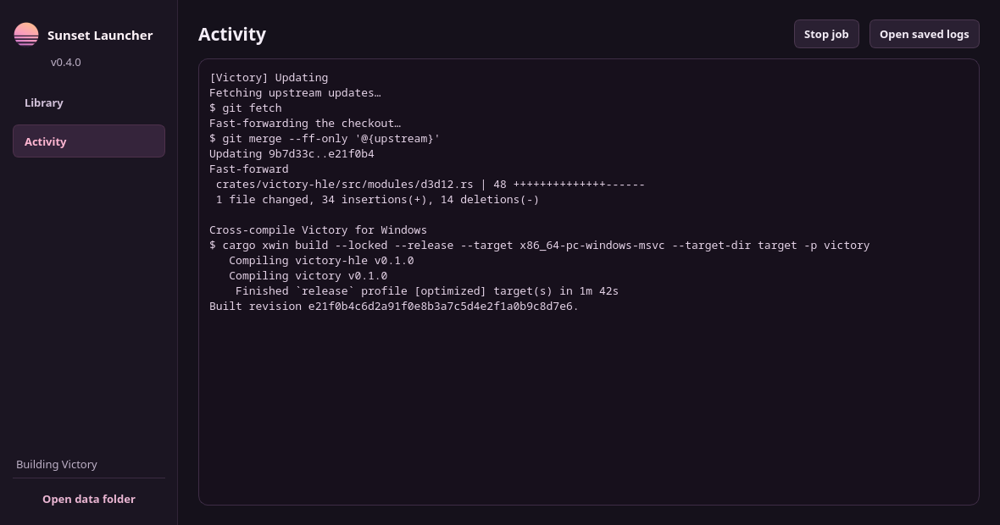

<div align="center">

# 🌅 Sunset Launcher

**Build, update and launch Xbox Series compatibility layers from one app.**

[](https://github.com/PelvisBass/Sunset-Launcher/releases/latest)
[](https://github.com/PelvisBass/Sunset-Launcher/actions/workflows/ci.yml)

[](LICENSE)


</div>

Sunset Launcher clones each compatibility layer from upstream and compiles it with your local toolchain. It keeps each build current and launches your game through it, using Proton on Linux or running it natively on Windows.

## ⬇️ Download

| Platform | Download | Run |
| --- | --- | --- |
| 🐧 **Linux** x86-64 (glibc 2.35+, e.g. Ubuntu 22.04 or newer) | [`SunsetLauncher-linux-x86_64.tar.gz`](https://github.com/PelvisBass/Sunset-Launcher/releases/latest) | Extract it, then run `SunsetLauncher/SunsetLauncher` |
| 🪟 **Windows** x86-64 | [`SunsetLauncher-windows-x86_64.zip`](https://github.com/PelvisBass/Sunset-Launcher/releases/latest) | Extract it, then run `SunsetLauncher\SunsetLauncher.exe` |

Keep the extracted folder together, including `_internal`. The Windows build is unsigned, so SmartScreen may ask once: select **More info**, then **Run anyway**. Checksums are in `SHA256SUMS` on each release, and the launcher tells you when a newer release is out.

## 🎮 Supported layers

| Project | Linux | Windows |
| --- | --- | --- |
| [XCL](https://github.com/xcl-dev/xcl) | ✅ Proton (experimental) | ✅ Native |
| [Victory](https://github.com/Marvisak/VIctory) | ✅ Proton (experimental) | ✅ Native |
| [TuxBox](https://github.com/brcly/TuxBox) | ✅ Managed by TuxBox | — Linux only |
| [hyphennn](https://github.com/fxceless/victory-fork) | ✅ Proton (experimental) | ✅ Native |
| [ZTRX](https://github.com/Zettrox/ztrx) | ✅ Proton (experimental) | ✅ Native, NVIDIA RTX |
| [DexNom Runtime](https://github.com/DexNom/VIctory) | ✅ Proton (experimental) | ✅ Native |

Whether a particular title runs depends on the upstream project, the build and your hardware.

## ✨ Features

- **One-click builds:** clone, compile and track each layer's upstream commit. **Update & build all** follows the project order, which you can change by dragging.
- **Update checks:** at startup the launcher shows **Up to date** or **Update available** for each build.
- **Proton on Linux:** finds Steam, Flatpak, umu, Lutris and Heroic Proton builds. It prefers `umu-run`, and each project gets its own prefix.
- **Launch options:** per-project settings in the style of Steam's launch options. `VAR=value` entries set environment variables, and the remaining arguments go where each layer expects them.
- **Shader cache:** shows each project's cache size at startup and clears it on request.
- **Shared game path:** pick a game once and launch it with any layer.
- **Activity log:** live output from every job, with the last two job logs kept.



## 🚀 Quick start

1. Install **Git**. Select a project and open **Build setup** for its toolchain, usually Rust plus a few extras.
2. Select **Build**. If something is missing, the project shows **Needs setup** and **Activity** lists what to install.
3. Set **Shared game path**, pick a **Proton version** on Linux, and select **Launch**.

<details>
<summary><b>Layer notes and tips</b></summary>

- **XCL on Linux:** stock Proton can fail before rendering. Under **Wine prefix**, select a prefix prepared with DXVK and an XCL-compatible vkd3d-proton build. Place the matching x64 `dxcompiler.dll` and `dxil.dll` from a [DXC release](https://github.com/microsoft/DirectXShaderCompiler/releases) beside `xcl.exe`.
- **Victory and hyphennn:** some titles need a native Microsoft D3DCompiler DLL in the prefix.
- **DexNom Runtime on Linux:** the build needs PowerShell (`pwsh`) to download and verify its format tables.
- **TuxBox:** selects its own Proton through umu. Some titles need its built providers staged first. See the [Lanes example](https://github.com/brcly/TuxBox/blob/main/examples/lanes/README.md#build-and-play).
- **Launch argument placement:**

  | Layer | Where launch arguments go |
  | --- | --- |
  | XCL | To the game |
  | Victory, hyphennn, ZTRX, DexNom Runtime | To the layer. Arguments after `--` go to the game |
  | TuxBox | To the layer |

- **Build tools in the data folder:** on Linux, tools placed under `build-tools/` in the data folder are picked up. These include Cargo and Rustup, MinGW-w64, DXC and the cargo-xwin SDK cache.
- **Delete build…** removes only recorded build outputs. Checkouts, caches, saves, game files and prefixes stay.
- **Open data folder** holds the checkouts, preferences and logs.

</details>

## 🛠️ Build from source

With [uv](https://docs.astral.sh/uv/getting-started/installation/) installed:

```sh
uv run --locked sunset-launcher                                  # run from source
uv run --locked python -m unittest discover -s tests             # run the tests
uv run --locked --extra bundle python scripts/build_bundle.py    # build dist/SunsetLauncher
```

<details>
<summary><b>Without uv (Python 3.10+)</b></summary>

```sh
python3 -m venv .venv && .venv/bin/pip install . && .venv/bin/sunset-launcher
```

On Windows, use `py -m venv .venv`, then `.venv\Scripts\pip install .` and `.venv\Scripts\sunset-launcher.exe`.

</details>

**Adding a layer:** add a `Project` with a `Recipe` per OS to [`catalog.py`](src/sunset_launcher/catalog.py). A recipe lists the required tools, build steps, the artifact, the launch command and the runtime.

## 📄 License and credits

MIT licensed. Release bundles include Qt, PySide6 and CPython under their own licenses; see `THIRD_PARTY_NOTICES.txt` in the download. The banner photo is [*Miami Sunset*](https://commons.wikimedia.org/wiki/File:Miami_Sunset_\(45863661094\).jpg) by Joe deSousa, released under [CC0](https://creativecommons.org/publicdomain/zero/1.0/).
