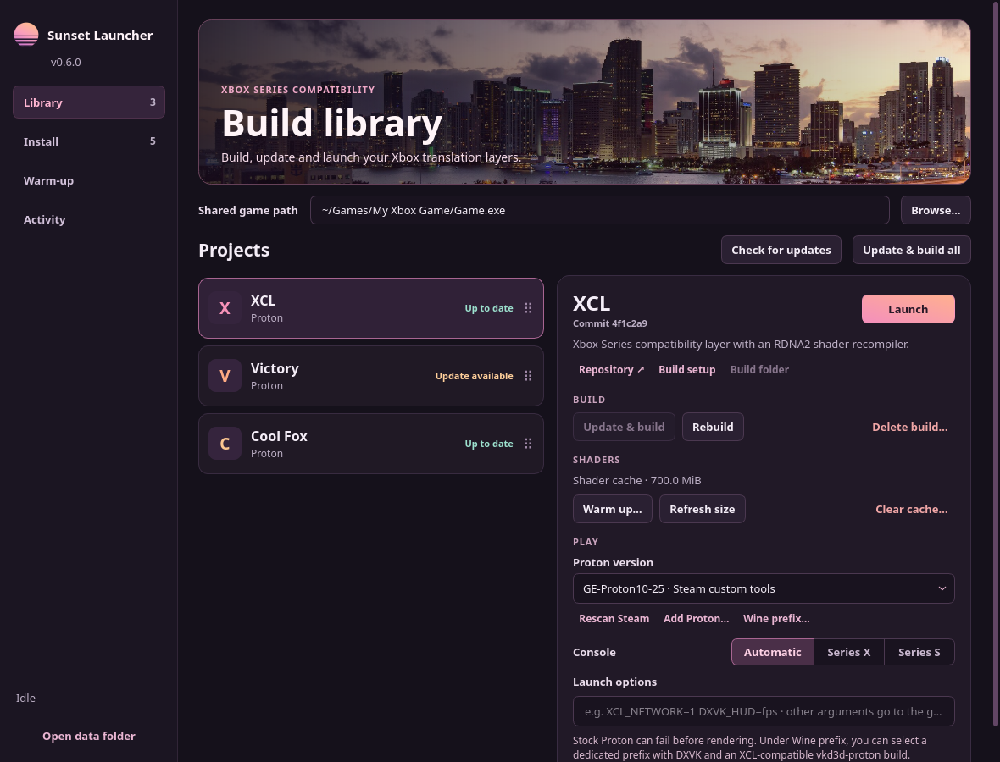
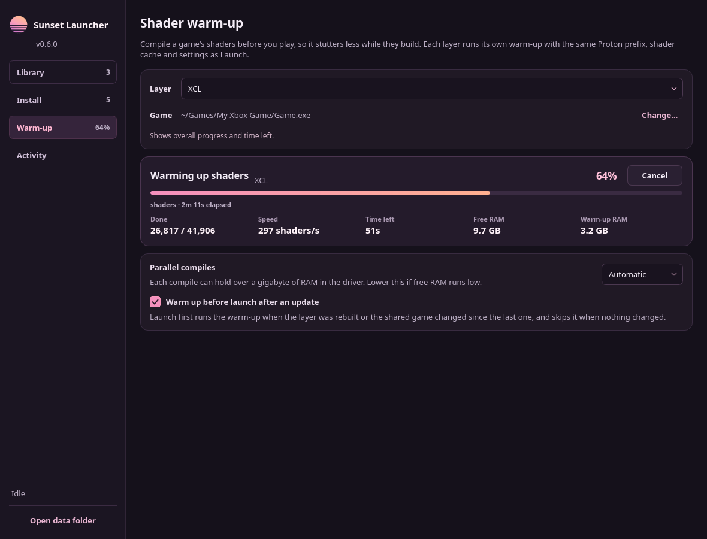

<div align="center">

# 🌅 Sunset Launcher

**Build, update and launch Xbox Series compatibility layers from one app.**

[](https://github.com/PelvisBass/Sunset-Launcher/releases/latest)
[](https://github.com/PelvisBass/Sunset-Launcher/actions/workflows/ci.yml)

[](LICENSE)



</div>

Sunset Launcher clones each compatibility layer from upstream and compiles it with your local toolchain. It keeps each build current and launches your game through it, using Proton on Linux or running it natively on Windows.

## ⬇️ Download

| Platform | Download | Run |
| --- | --- | --- |
| 🐧 **Linux** x86-64 (glibc 2.35+, e.g. Ubuntu 22.04 or newer) | [`SunsetLauncher-linux-x86_64.tar.gz`](https://github.com/PelvisBass/Sunset-Launcher/releases/latest) | Extract it, then run `SunsetLauncher/SunsetLauncher` |
| 🪟 **Windows** x86-64 | [`SunsetLauncher-windows-x86_64.zip`](https://github.com/PelvisBass/Sunset-Launcher/releases/latest) | Extract it, then run `SunsetLauncher\SunsetLauncher.exe` |

Keep the extracted folder together, including `_internal`. The Windows build is unsigned, so SmartScreen may ask once: select **More info**, then **Run anyway**. Checksums are in `SHA256SUMS` on each release, and the launcher tells you when a newer release is out.

## 🎮 Supported layers

| Project | Linux | Windows |
| --- | --- | --- |
| [XCL](https://github.com/xcl-dev/xcl) | ✅ Proton (experimental) | ✅ Native |
| [Victory](https://github.com/Marvisak/VIctory) | ✅ Proton (experimental) | ✅ Native |
| [TuxBox](https://github.com/brcly/TuxBox) | ✅ Managed by TuxBox | — Linux only |
| [hyphennn](https://github.com/fxceless/victory-fork) | ✅ Proton (experimental) | ✅ Native |
| [DexNom Runtime](https://github.com/DexNom/VIctory) | ✅ Proton (experimental) | ✅ Native |
| [AvatarManz](https://github.com/avatarmanz/VIctory-7900XTX) | ✅ Proton (experimental) | ✅ Native, tested on RX 7900 XTX |
| [Cool Fox](https://github.com/DoubleGhosty/cool_fox) (mirror) | ✅ Proton (experimental) | ✅ Native |
| [Scarlett 3070](https://github.com/Yaekai/victory-scarlett-3070) | ✅ Proton (experimental) | ✅ Native, tuned for 8 GB NVIDIA cards |

Cool Fox's original repository is offline, so the launcher builds from a mirror with the same history, and existing checkouts switch to it on their next update. Whether a particular title runs depends on the upstream project, the build and your hardware.

## ✨ Features

- **Install tab:** pick a layer and select **Install** to clone and build it. Your library lists only the layers you've installed.
- **Build tools on Windows:** the launcher checks for Git, Rust and the Visual Studio C++ Build Tools, and installs whichever are missing with winget when you install a layer.
- **Shader warm-up:** compile a game's shaders before you play, with live progress, speed, time left, free RAM and the warm-up's own RAM. It can run automatically before a launch after a layer update. Uses each layer's own warm-up tool (XCL, Victory, AvatarManz, Cool Fox, Scarlett 3070 and TuxBox).
- **One-click updates:** track each layer's upstream commit. **Update & build all** follows the library order, which you can change by dragging.
- **Update checks:** at startup the launcher shows **Up to date** or **Update available** for each build.
- **Proton on Linux:** finds Steam, Flatpak, umu, Lutris and Heroic Proton builds. It prefers `umu-run`, and each project gets its own prefix.
- **Console choice:** run a game as a Series X or Series S with one click, for every layer that supports it.
- **Launch options:** per-project settings in the style of Steam's launch options. `VAR=value` entries set environment variables, and the remaining arguments go where each layer expects them.
- **Presets:** layers that ship tuned settings (AvatarManz, Cool Fox and Scarlett 3070) list them under **Preset**, marking any you've overridden in Launch options.
- **Shader cache:** shows each project's cache size at startup and clears it on request.
- **Shared game path:** pick a game once and launch it with any layer.
- **Activity log:** live output from every job, with the last two job logs kept.



## 🚀 Quick start

1. Open **Install** and select **Install** on a layer.
   - **Windows:** the **Build tools** card shows what's missing. The launcher offers to install it with winget and asks before it starts. Windows then asks for administrator permission, and the C++ Build Tools (about 7 GB) take 10 to 30 minutes.
   - **Linux:** install Git and the tools in the layer's **Requirements** (usually Rust plus a few extras) first.
2. If something is still missing, the layer shows **Needs setup** and **Activity** lists what to install. Once it builds, it moves to **Library**.
3. Set **Shared game path**, pick a **Proton version** on Linux, and select **Launch**. Use **Warm-up** first to compile the game's shaders ahead of time.

<details>
<summary><b>Layer notes and tips</b></summary>

- **XCL on Linux:** stock Proton can fail before rendering. Under **Wine prefix**, select a prefix prepared with DXVK and an XCL-compatible vkd3d-proton build. Place the matching x64 `dxcompiler.dll` and `dxil.dll` from a [DXC release](https://github.com/microsoft/DirectXShaderCompiler/releases) beside `xcl.exe`.
- **Victory and hyphennn:** some titles need a native Microsoft D3DCompiler DLL in the prefix.
- **DexNom Runtime on Linux:** the build needs PowerShell (`pwsh`) to download and verify its format tables.
- **AvatarManz, Cool Fox and Scarlett 3070:** each comes preset with its upstream renderer settings ([AvatarManz](https://github.com/avatarmanz/VIctory-7900XTX#how-to-run-it), [Cool Fox](https://github.com/DoubleGhosty/cool_fox#run-the-codec_d-windows-build), [Scarlett 3070](https://github.com/Yaekai/victory-scarlett-3070#build-and-run-quick-start)). Add `VAR=value` in **Launch options** to override any of them.
- **Cool Fox on a 4 GB card:** add `VICTORY_CARD_BUFFERS_MB=256 VICTORY_CARD_BUFFERS_MIN_KB=4096 VICTORY_D3D12_BACKGROUND=0` to **Launch options** and choose **Series S**, as upstream's `Play-VIctory-4GB.cmd` does.
- **Scarlett 3070 on 12 GB or more:** add `VICTORY_TEXTURE_MIP_DROP=0` to **Launch options** for full-resolution textures, and choose **Series X** on a faster GPU.
- **Console:** pick **Series X** or **Series S** for Victory and its forks. Scarlett 3070 defaults to Series S, the others to Series X. XCL also offers **Automatic**, which uses the game's own setting, and passes your choice as `XCL_DEVICE_TYPE`.
- **TuxBox:** selects its own Proton through umu. Some titles need its built providers staged first. See the [Lanes example](https://github.com/brcly/TuxBox/blob/main/examples/lanes/README.md#build-and-play).
- **Launch argument placement:**

  | Layer | Where launch arguments go |
  | --- | --- |
  | XCL | To the game |
  | Victory and its forks | To the layer. Arguments after `--` go to the game |
  | TuxBox | To the layer |

- **Windows without winget:** on older Windows 10 builds without App Installer, the **Build tools** card opens each tool's download page instead. Install them, then select **Check again**.
- **Build tools in the data folder:** on Linux, tools placed under `build-tools/` in the data folder are picked up. These include Cargo and Rustup, MinGW-w64, DXC and the cargo-xwin SDK cache.
- **Warm-up progress:** XCL reports overall progress and time left. Victory works through the game's files one at a time, so its percentage and time left are for the current file. AvatarManz, Cool Fox and Scarlett 3070 report a running count without a total. TuxBox prepares shaders with its own per-title profiles and reports no counts. hyphennn and DexNom Runtime have no warm-up the launcher can run. On Linux, the warm-up runs through Proton's `runinprefix` so its progress reaches the launcher. Victory's warm-up translates shaders only: its pipeline pre-build has nowhere to keep pipelines under Proton and stops the run.
- **Parallel compiles:** each compile can hold over a gigabyte of RAM in the driver. Lower **Parallel compiles** on the Warm-up page if free RAM runs low.
- **Delete build…** removes only recorded build outputs and moves the layer back to **Install**. Checkouts, caches, saves, game files and prefixes stay.
- **Open data folder** holds the checkouts, preferences and logs.

</details>

## 🛠️ Build from source

With [uv](https://docs.astral.sh/uv/getting-started/installation/) installed:

```sh
uv run --locked sunset-launcher                                  # run from source
uv run --locked python -m unittest discover -s tests             # run the tests
uv run --locked --extra bundle python scripts/build_bundle.py    # build dist/SunsetLauncher
```

<details>
<summary><b>Without uv (Python 3.10+)</b></summary>

```sh
python3 -m venv .venv && .venv/bin/pip install . && .venv/bin/sunset-launcher
```

On Windows, use `py -m venv .venv`, then `.venv\Scripts\pip install .` and `.venv\Scripts\sunset-launcher.exe`.

</details>

**Adding a layer:** add a `Project` with a `Recipe` per OS to [`catalog.py`](src/sunset_launcher/catalog.py). A recipe lists the required tools, build steps, the artifact, the launch command and the runtime.

## 📄 License and credits

MIT licensed. Release bundles include Qt, PySide6 and CPython under their own licenses; see `THIRD_PARTY_NOTICES.txt` in the download. The banner photo is [*Miami Sunset*](https://commons.wikimedia.org/wiki/File:Miami_Sunset_\(45863661094\).jpg) by Joe deSousa, released under [CC0](https://creativecommons.org/publicdomain/zero/1.0/).
